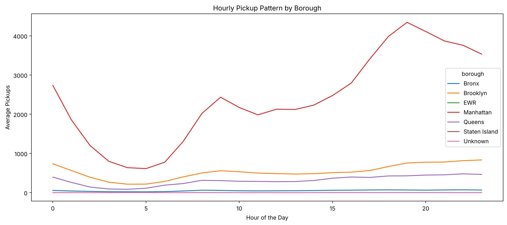
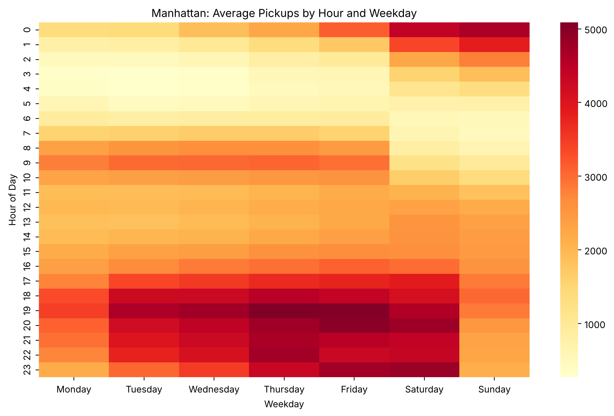
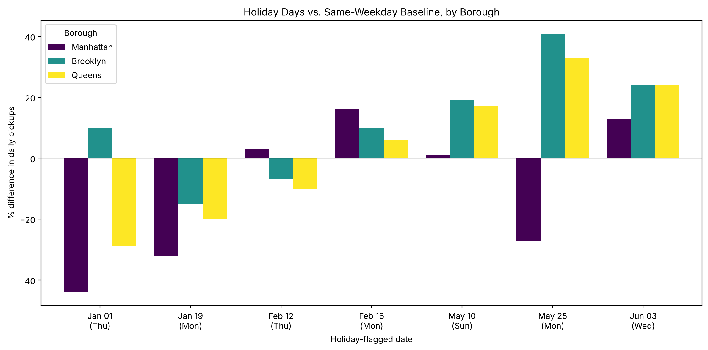

# Uber NYC Pickups: Demand Pattern Analysis

> Exploratory and statistical analysis of hourly Uber pickups across New York City boroughs (January to June 2015), combined with weather and holiday data, to find demand patterns the business can act on.

[](https://colab.research.google.com/github/Bilal-Butt/Uber-Data-Analysis/blob/main/notebooks/uber_nyc_pickups_analysis.ipynb)


---

## Business problem

Ridesharing demand shifts with time, location, weather and local events. Matching driver supply to those shifts reduces rider wait times and lost trips. As a data scientist in Uber's New York office, the task is to extract insights that are potentially actionable.

**Key questions**
1. Which variables influence pickups?
2. Which factor affects pickups the most, and why might that be?
3. What should Uber management do to capitalise on fluctuating demand?

## Dataset

`data/Uber.csv`: 29,101 rows, 13 columns. Each row is one borough in one hour (2015-01-01 01:00 to 2015-06-30 23:00).

| Column | Description |
|---|---|
| `pickup_dt` | Date and time of the pickup period (hourly) |
| `borough` | NYC borough (Bronx, Brooklyn, EWR, Manhattan, Queens, Staten Island); 3,043 rows are missing |
| `pickups` | Number of pickups in the period |
| `spd`, `vsb`, `temp`, `dewp`, `slp` | Wind speed, visibility, temperature, dew point, sea-level pressure |
| `pcp01`, `pcp06`, `pcp24` | Precipitation over the past 1, 6 and 24 hours |
| `sd` | Snow depth (inches) |
| `hday` | Holiday indicator (`Y` / `N`) |

## Approach

1. **Profiling and cleaning:** shape, types, missing values; the 3,043 missing boroughs are labelled `"Unknown"` instead of dropped, so their weather data is kept.
2. **Validation:** pandas statistics cross-checked against NumPy.
3. **Feature engineering:** month, day, weekday and hour from the timestamp.
4. **Selection and aggregation:** `loc` / `iloc`, conditional indexing, `groupby` by borough, holiday and both.
5. **Visual analysis:** distribution of pickups, hourly profile by borough, temperature scatter, Manhattan hour x weekday heat map.
6. **Quantifying the drivers:** R-squared by factor, weather correlations, and a day-level holiday comparison against same-weekday baselines.

## Key findings

| # | Finding | Evidence |
|---|---|---|
| 1 | **Location dominates demand** | Manhattan averages 2,387 pickups per hour (about 73% of all pickups); Brooklyn 534, Queens 309, Bronx 51, Staten Island 1.6, EWR 0.02. Borough alone explains **67%** of the variation in pickups |
| 2 | **Hour of day is the next driver** | Borough x hour explains **87%**. In Manhattan, hour alone explains 62%; demand peaks at **19:00 (about 4,300)** and bottoms out at 04:00-05:00 (about 600) |
| 3 | **Busiest windows are weekday evenings and weekend nights** | Thu 19:00 (about 5,090), Fri 19:00 (5,030), Fri 20:00 (4,980), Sat 23:00 (4,820). Friday and Saturday are the busiest days, Monday the quietest |
| 4 | **Weather is a weak driver** | All correlations are 0.16 or less; weather adds only about 0.5 points of explained variance in Manhattan once time is controlled. Rain hours show a suggestive uplift of about 9% |
| 5 | **Holiday effects are inconsistent** | Holiday hours average 11% lower overall, but only 7 days are flagged. Against same-weekday baselines Manhattan fell 44%, 32% and 27% on three days and was flat or higher on four. On May 25 Manhattan fell 27% while Brooklyn rose 41% |
| 6 | **Pickups are heavily right-skewed** | Mean 490 vs median 54, maximum 7,883; 19% of rows are zero (almost all EWR and Staten Island) |

<p align="center">
  <br>
  <em>Manhattan dwarfs every other borough and peaks in the evening.</em>
</p>

<p align="center">
  <br>
  <em>The busiest cells are Thursday and Friday evenings and Saturday night.</em>
</p>

<p align="center">
  <br>
  <em>Holiday effects differ by holiday and by borough; there is no single holiday drop.</em>
</p>

## Recommendations

1. **Position supply in Manhattan for the evening peak:** concentrate driver availability and incentives at 18:00-22:00, especially Thursday and Friday, plus Saturday night.
2. **Use the hour x weekday view for incentive planning:** target windows where demand is high and supply is likely short, and avoid paying for supply in the 03:00-06:00 trough.
3. **Do not apply a blanket holiday policy:** effects differ by holiday and borough. Build holiday-specific forecasts once more history exists.
4. **Treat weather as a secondary signal:** test rain as an uplift flag in a forecasting model instead of building weather-driven staffing rules.
5. **Review EWR and Staten Island coverage:** EWR has zero pickups in 4,243 of 4,343 hours and Staten Island in 1,291, which suggests minimal service or incomplete data.
6. **Next step:** a demand forecasting model (for example gradient boosting) with borough, hour, weekday, holiday, weather and lagged pickups, trained on at least a full year of data.

Full detail is in [`docs/findings_and_recommendations.md`](docs/findings_and_recommendations.md).

## Limitations

- Six months of data: seasonality across a year cannot be assessed, and only 7 days carry the holiday flag.
- Hourly observations are autocorrelated, so significance tests that treat every hour as independent would be misleading; effects are described, not tested.
- 3,043 rows have no borough (under 0.1% of pickups); the cause is unconfirmed.
- Demand only: there is no supply, wait-time or price data, so the recommendations assume supply can follow demand.
- Results are associations, not causal effects.

## Repository structure

```
Uber-Data-Analysis/
├── notebooks/
│   └── uber_nyc_pickups_analysis.ipynb   # full analysis (runs top to bottom)
├── data/
│   └── Uber.csv
├── docs/
│   ├── findings_and_recommendations.md   # curated findings, tables and recommendations
│   └── notebook_text_full.md             # all narrative text from the notebook
├── images/                                # charts used in this README
├── requirements.txt
├── LICENSE
└── README.md
```

## How to run

**Google Colab (easiest):** click the *Open in Colab* badge above. The notebook downloads the data from this repository automatically.

**Locally:**

```bash
git clone https://github.com/Bilal-Butt/Uber-Data-Analysis.git
cd Uber-Data-Analysis
python -m venv .venv && source .venv/bin/activate   # Windows: .venv\Scripts\activate
pip install -r requirements.txt
jupyter notebook notebooks/uber_nyc_pickups_analysis.ipynb
```

## Tech stack

Python, pandas, NumPy, statsmodels, Matplotlib, Seaborn, Jupyter / Google Colab.

## Author

**Muhammad Bilal Butt**, Data Analyst.
[GitHub](https://github.com/Bilal-Butt) | [LinkedIn](https://www.linkedin.com/in/muhammad-bilal-butt-03a476232)

Released under the [MIT License](LICENSE).
